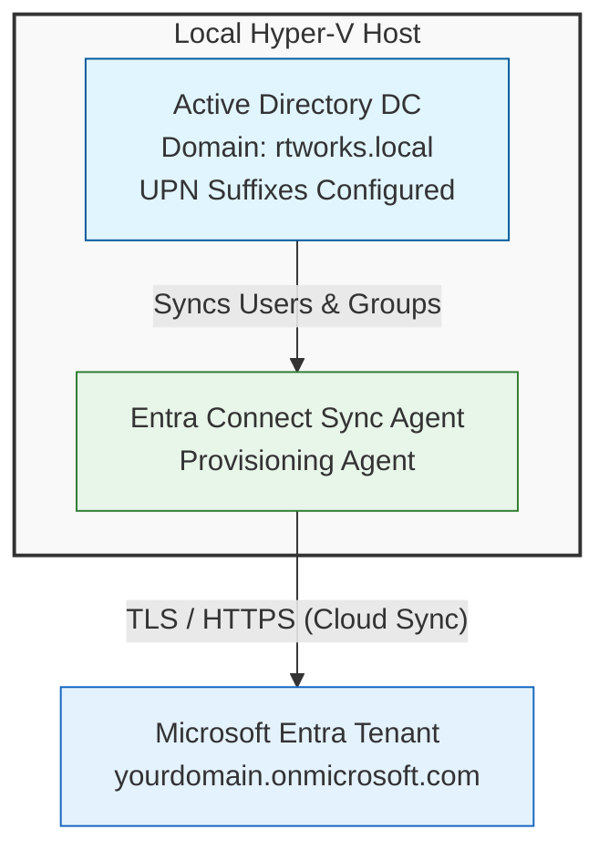

# Hybrid Identity & Entra ID UPN Synchronization Lab

**Automated on-premises Active Directory and Microsoft Entra ID hybrid identity lab environment featuring modular PowerShell scripts, UPN synchronization, automated user/group provisioning, dynamic department sub-OUs, and comprehensive Pester v6 infrastructure validation tests.**

## Overview
This repository provides a production-grade, automated infrastructure framework for building, configuring, and validating a hybrid identity environment. Designed for identity and access management (IAM) engineers, administrators, and professionals preparing for certifications like the Microsoft SC-300, this lab bridges on-premises Active Directory Domain Services (AD DS) with Microsoft Entra ID.

The lab utilizes modular, repeatable PowerShell scripts to automate the entire deployment lifecycle—from foundational forest and domain creation to User Principal Name (UPN) suffix routing, dynamic department sub-OU provisioning, bulk user and security group creation, and attribute synchronization updates. Infrastructure health, CSV parity, and configuration compliance are continuously verified using automated Pester v6 unit test suites.

## Key Features & Capabilities
- **Automated Active Directory Deployment:** Streamlined installation of AD DS, domain configuration, and hierarchical OU management (`CorpUsers`, and all 10 departmental sub-containers like `IT`, `HR`, `Finance`, `Sales`, `Marketing`, `Engineering`, `Operations`, `Legal`, `Product`, and `Customer Support`).
- **Entra-Ready UPN Suffix Management:** Configures and maps verified custom domain UPN suffixes (`@yourdomain.onmicrosoft.com`) to eliminate default `.local` routing issues during hybrid synchronization.
- **Repeatable & Safe-to-Rerun Bulk User & Group Provisioning:** Parses CSV datasets (`C:\poshlog\users.csv`) to automatically create user objects inside dynamic department sub-OUs, construct proper full-name display attributes, and provision department-aligned security groups (`$Dept-Security-Group`) without creating duplicates if run multiple times.
- **Automated Department Transfers & Migrations:** Repeat-safe attribute updating scripts (`05-Update-ADUsers.ps1`) that detect department changes, dynamically move user objects across sub-OUs, and update security group memberships.
- **Hybrid Identity Synchronization:** Configures local Microsoft Entra Connect Cloud Sync agents (`AADConnectProvisioningAgent`) to establish secure cloud-to-on-prem directory synchronization.
- **Comprehensive Pester v6 Testing:** Includes automated test suites (`tests/IdentityLab.Tests.ps1`) to validate Active Directory health, all 10 department OUs, security group scopes, user attribute formatting, and CSV record parity.

---

## Architecture Overview



## Repository Structure

Plaintext

```
entra-hybrid-identity-lab/
├── .github/
│   └── workflows/
│       └── pester-tests.yml    # Automated GitHub Actions CI/CD test pipeline
├── docs/
│   ├── architecture.md
│   └── images/                 # Screenshots and visual assets directory
├── scripts/
│   ├── 01-Install-ADDS.ps1
│   ├── 02-Configure-UPNSuffixes.ps1
│   ├── 03-BulkImport-Users.ps1
│   ├── 04-Configure-CloudSync.ps1
│   └── 05-Update-ADUsers.ps1
├── tests/
│   └── IdentityLab.Tests.ps1   # Pester v6 validation suite for all 10 OUs & groups
├── data/
│   └── users.csv               # Sample CSV dataset
├── .gitignore
├── LICENSE
└── README.md

```

## Prerequisites & Requirements

-   **Operating System:** Windows Server 2022 or Windows 11 Enterprise (Hyper-V enabled).
    
-   **Permissions:** Local Administrator rights on the target domain controller/management workstation.
    
-   **Modules Required:**  `ActiveDirectory`,  `Pester` (v6.2.0+).
    
-   **CSV Data Path:**  `C:\poshlog\users.csv` formatted with headers:`Name,LastName,DisplayName,UserPrincipalName,SamAccountName,Department,Title,Office,Password`
    

## Quick Start Guide

### 1. Initialize Active Directory & Configure UPN Suffixes

Execute the foundational deployment and configure your verified Entra domain UPN suffix:

Code snippet

```
# 01 - Install AD DS Forest and Domain
.\scripts\01-Install-ADDS.ps1

```

Code snippet

```
# 02 - Configure UPN Suffixes
.\scripts\02-Configure-UPNSuffixes.ps1 -CustomUpnSuffix "yourdomain.onmicrosoft.com"

```

### 2. Bulk Import Users and Provision Department Security Groups

Run the bulk import script to automatically create the root `CorpUsers` container, all 10 dynamic department sub-OUs, construct full display names, and provision department-aligned security groups:

PowerShell

```
# 03 - Bulk Import Users, Department Sub-OUs, and Security Groups
.\scripts\03-BulkImport-Users.ps1

```

-   **Verification:** Run `Get-ADGroup -Filter "Name -like '*-Security-Group'"` in PowerShell to confirm all department-aligned security groups were successfully provisioned.
    

### 3. Update Existing User Attributes and Sub-OU Placement

To apply repeat-safe updates, propagate naming standard changes, or automatically relocate existing accounts into their proper department sub-containers uniformly:

Code snippet

```
# 05 - Update Existing User Attributes and Sub-OU Placement
.\scripts\05-Update-ADUsers.ps1

```

### 4. Run Infrastructure Validation Tests

Verify Active Directory health, all 10 department OUs, security group scopes, OU hierarchy, and CSV user parity using Pester v6:

Code snippet

```
# IdentityLab - Pester Infrastructure Validation Suite
Invoke-Pester -Path .\tests\IdentityLab.Tests.ps1 -Output Detailed

```

### Verification Commands

To verify that user display names and attributes are correctly populated across Active Directory:

Code snippet

```
Get-ADUser -Filter * -SearchBase "OU=CorpUsers,DC=rtworks,DC=local" -Properties DisplayName, Department | Format-Table SamAccountName, Name, DisplayName, Department -AutoSize

```

## Reference & Learning Resources

This lab builds upon core Microsoft hybrid identity deployment patterns. For official documentation on setting up foundational Active Directory and cloud sync architectures, refer to:

-   [Microsoft Tutorial: Basic Active Directory and Entra Connect Cloud Sync](https://learn.microsoft.com/)
    

## License

This project is licensed under the MIT License - see the LICENSE file for details.