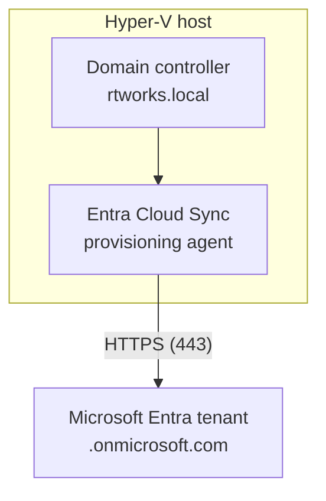

# Hybrid Identity Lab: Active Directory to Microsoft Entra ID

A hands-on lab that connects an on-premises Active Directory forest (`rtworks.local`) to a Microsoft Entra tenant with Entra Cloud Sync, and shows what happens to user principal names (UPNs) along the way. The PowerShell scripts provision users from a CSV, keep them in line with that CSV, and move them to a new UPN suffix. Pester tests check the scripts.

I built this while preparing for SC-300 (passed October 2026).

## Project status

| Phase | Scope | Status |
| --- | --- | --- |
| 1. Hybrid identity | AD forest synced to Entra with Cloud Sync; UPN migration to the tenant suffix | Done, evidenced |
| 2. Joiner / mover / leaver | PowerShell JML scripts, Pester unit tests, CI on every push | Done, evidenced |
| Tenant security baseline | Least-privilege admin roles, two emergency access accounts, MFA on every account | Done; screenshots being added |
| 3. Automation with Microsoft Graph | GitHub Actions signs in with OIDC (no stored secret), deploys Conditional Access policies in report-only mode, Pester reads them back through Graph | In progress |

## What the lab shows

The scripts cover the whole joiner / mover / leaver (JML) lifecycle: 03 creates joiners, 05 handles movers and leavers.

1. Users are created on the forest's own suffix, `@rtworks.local`, and synced to Entra.
2. In the cloud, a non-routable `.local` UPN is replaced with the tenant's `.onmicrosoft.com` suffix. The on-premises and cloud UPNs do not match. (Cloud Sync matches objects on a source anchor, `ms-DS-ConsistencyGuid` with a fallback to `objectGUID`, not the UPN, so the sync works. See the Cloud Sync FAQ under Credits.)
3. The tenant suffix is registered in the forest, and every user is moved to it.
4. After the next sync, the on-premises and cloud UPNs match.

Evidence for each stage (screenshots and exported results) is in `docs/`. See [Results](#results).

## Tenant security baseline

Set up before Phase 3, so the automation runs in a tenant that is already locked down. Details and the reasons for each choice are in [`docs/REQUIREMENTS.md`](docs/REQUIREMENTS.md) (P-03, R-62 to R-66).

- **Least privilege for people.** Each admin task has its own least-privileged Entra role (User Administrator, Authentication Policy Administrator, Privileged Role Administrator, Conditional Access Administrator, Application Developer, Reports Reader, Hybrid Identity Administrator). Each role is held by one dedicated cloud-only admin account, never by a day-to-day account or a user synced from `rtworks.local`, so an on-premises compromise can't reach a cloud admin role.
- **Emergency access.** Two cloud-only break-glass accounts hold Global Administrator with an active, permanent assignment and passkey (FIDO2) sign-in, tested. The goal is for them to be the only standing Global Administrators (R-63). The Global Administrator account used during setup was retired (role removed, sign-in blocked, not deleted).
- **MFA everywhere.** The tenant is on Entra ID Free with security defaults off (P-02), so per-user MFA is enforced on every admin and emergency access account and on all 100 synced users (password hash sync is on). The synced-user change was made through Microsoft Graph with a `-WhatIf` dry run first, and each change was read back.
- **Read-only Graph access for admins.** Tenant-wide consent was granted only for the named delegated scopes the checks need, through the admin consent endpoint.
- **Recorded exceptions.** Steps that had to be done by a Global Administrator before any admin role existed are written up as a bootstrap exception, and one step done by the wrong account is recorded as a deviation rather than redone.

## What is scripted and what is not

| Part | How it was done |
| --- | --- |
| Forest, domain controller and Hyper-V VM | Built by hand, following Microsoft's *Building a basic Active Directory environment* tutorial (see Credits). Not scripted. |
| Cloud Sync agent install and configuration | Done by hand in the Entra admin center. Script 04 only *checks* the agent's health. |
| OU, UPN suffix, users, groups, updates, UPN change | Scripts 01, 02, 03, 05 and 06. |

## Repository structure

```
entra-hybrid-identity-lab/
├── .github/workflows/pester-tests.yml   # CI: script analysis + unit tests
├── data/users.csv                       # 100 sample users (no passwords)
├── docs/
│   ├── REQUIREMENTS.md                  # Testable requirements for this repo
│   ├── architecture.md
│   └── images/                          # Screenshots and evidence
├── scripts/
│   ├── LabCommon.ps1                    # Shared helpers (CSV validation, DN helpers)
│   ├── 01-Initialize-OUStructure.ps1    # Creates OU=CorpUsers
│   ├── 02-Configure-UPNSuffixes.ps1     # Registers a UPN suffix in the forest
│   ├── 03-BulkImport-Users.ps1          # Department OUs, groups and users from the CSV
│   ├── 04-Test-CloudSyncAgent.ps1       # Read-only health check of the sync agent
│   ├── 05-Update-ADUsers.ps1            # Movers and leavers: brings AD back in line with the CSV
│   └── 06-Set-UserUPN.ps1               # Moves users to a new UPN suffix
├── tests/
│   ├── TestSetup.ps1                    # Stand-in AD cmdlets for machines without RSAT
│   ├── Data.Tests.ps1                   # Helpers and users.csv
│   ├── Scripts.Tests.ps1                # Mocked tests for scripts 01-06
│   └── IdentityLab.Integration.Tests.ps1  # Needs a real domain controller
├── PSScriptAnalyzerSettings.psd1
├── LICENSE
└── README.md
```

## Architecture



## Prerequisites

- A working forest and domain controller (see the first Microsoft tutorial under Credits).
- The `ActiveDirectory` PowerShell module (installed on a domain controller, or through RSAT).
- Rights to create OUs, users and groups. Script 02 changes the forest, so it needs Enterprise Admins.
- Pester 6.2.0 and PSScriptAnalyzer 1.24.0 to run the checks locally. CI uses the same versions.
- Works on Windows PowerShell 5.1 (the lab DC ran every script on 5.1.20348) and PowerShell 7 (CI runs on `pwsh`, `windows-latest`).
- An Entra tenant with Cloud Sync set up, with the sync scope covering `OU=CorpUsers` and its sub-OUs.

## The CSV

`data/users.csv` has these columns. `GivenName`/`Surname` are accepted in place of `Name`/`LastName`.

```
Name,LastName,DisplayName,UserPrincipalName,SamAccountName,Department,Title,Office
```

There is no password column. Every script validates the whole file first and reports all problems at once, before it changes anything.

## Running the lab

All scripts support `-WhatIf`. Run with `-WhatIf` first to see what would change. The scripts end with an error if any user failed, so the exit code can be trusted.

### 1. Create the root OU

```powershell
.\scripts\01-Initialize-OUStructure.ps1
```

### 2. Create department OUs, groups and users (on `.local`)

The initial password is requested as a secure string, is never stored, and each user must change it at first sign-in.

```powershell
$pw = Read-Host -AsSecureString -Prompt 'Initial password'
.\scripts\03-BulkImport-Users.ps1 -InitialPassword $pw
```

Optional: `-CsvPath` for another file, `-RootTargetOU` for a different root OU (default `OU=CorpUsers,<your domain>`).

### 3. Check the sync agent, then sync and record the baseline

```powershell
.\scripts\04-Test-CloudSyncAgent.ps1
```

Run this on the server where the agent is installed. Scope the sync to a pilot OU first (this lab used `OU=IT`, 12 users), then widen it to `OU=CorpUsers`. In Entra, record the cloud UPN of a few users. Expect the tenant's `.onmicrosoft.com` suffix, not `.local`. Confirm this in your own tenant.

### 4. Movers and leavers: update AD after a CSV change

```powershell
.\scripts\05-Update-ADUsers.ps1 -WhatIf
.\scripts\05-Update-ADUsers.ps1
```

**Movers:** moves users to the right department OU, updates attributes, and fixes department group membership.

**Leavers:** an account under the root OU that is not in the CSV is a leaver. By default it is only reported (`NotInCsv`). To deprovision leavers, add `-ProcessLeavers`:

```powershell
.\scripts\05-Update-ADUsers.ps1 -ProcessLeavers -WhatIf
.\scripts\05-Update-ADUsers.ps1 -ProcessLeavers
```

For each leaver the script, in this order:

1. disables the account, so access stops first
2. removes it from the department security groups (other groups are left alone)
3. stamps the account Description with the leaver date
4. moves it to `OU=Disabled` under the root OU, last, so an interrupted run is picked up again

Nothing is deleted. `OU=Disabled` stays inside the root OU, so the disabled account stays in the Cloud Sync scope and the disable reaches Entra. Accounts already processed show as `AlreadyLeaver`.

The department groups sync to Entra too. A synced group's source of authority is AD, so Entra shows it as read-only: membership changes are made in AD (by 05) and arrive with the next sync.

Safeguards:

- `-MaxLeavers` (default 10): if more accounts than this would be processed, the script stops before any change. This protects against a wrong or truncated CSV disabling everyone.
- A CSV user found in the Disabled OU (a rehire) is reported as `Failed` and left alone. Re-enable and move the account by hand first.
- `-DisabledOUName` changes the OU name (default `Disabled`). The OU is created if it does not exist.

### 5. Migrate to the tenant suffix

```powershell
.\scripts\02-Configure-UPNSuffixes.ps1 -CustomUpnSuffix '<tenant>.onmicrosoft.com'
.\scripts\06-Set-UserUPN.ps1 -NewSuffix '<tenant>.onmicrosoft.com' -WhatIf
.\scripts\06-Set-UserUPN.ps1 -NewSuffix '<tenant>.onmicrosoft.com' -LogPath .\upn-migration.csv
```

Script 06 refuses a suffix that is not registered. Under `-WhatIf` it writes no log, so use `-LogPath` on the real run. The log shows each user's UPN before and after; it is ignored by Git, so review it and move it into `docs/` on purpose. Sync again and record the after state.

## Results

| Stage | Evidence | Shows |
| --- | --- | --- |
| Baseline, on-premises | [`01-baseline-onprem-upn.png`](docs/images/01-baseline-onprem-upn.png) | Users on `@rtworks.local` |
| Baseline, cloud | [`02-baseline-cloud-upn.png`](docs/images/02-baseline-cloud-upn.png) | The same users in Entra on a different suffix: the UPNs don't match |
| Agent health | [`agent-health.png`](docs/images/agent-health.png) | Script 04: 9 of 9 checks pass |
| UPN migration | [`upn-migration.csv`](docs/upn-migration.csv) | 100 users, before and after UPN, all `Updated` |
| After, on-premises | [`03-after-onprem-upn.png`](docs/images/03-after-onprem-upn.png) | The same users on `@<tenant>.onmicrosoft.com` |
| After, cloud | [`04-after-cloud-upn.png`](docs/images/04-after-cloud-upn.png) | Cloud UPNs now match on-premises |
| Leaver, AD and Entra | [`leaver-before-after.png`](docs/images/leaver-before-after.png) | Account disabled, department group removed, moved to `OU=Disabled`; disabled in Entra, still synced |
| Leaver, group removal | [`leaver-group-audit.png`](docs/images/leaver-group-audit.png) | Entra audit log: member removed from the group |
| Leaver, sync | [`leaver-provisioning-log.png`](docs/images/leaver-provisioning-log.png) | Cloud Sync provisioning log: update from AD, `accountEnabled` set to false |

Notes:

- Script 06 was run without `-LogPath`, so `upn-migration.csv` was rebuilt from `data/users.csv` (before) and AD (after, with the replication timestamp of each change). Every row is marked `Source = Rebuilt`.
- The group audit entry was opened from the group's own audit log. Its group target shows no display name; the group's member list confirms the removal.
- Running 06 a second time changed nothing (`0 updated, 100 unchanged`).
- Tenant names and IDs are redacted in every image.

## Tests

```powershell
# Static analysis
Invoke-ScriptAnalyzer -Path .\scripts -Settings .\PSScriptAnalyzerSettings.psd1

# Unit tests (no domain controller needed)
Invoke-Pester -Path .\tests -ExcludeTag Integration

# Integration tests (on a domain controller or RSAT workstation)
Invoke-Pester -Path .\tests\IdentityLab.Integration.Tests.ps1 -Tag Integration
```

The unit tests mock Active Directory, so they check what each script *does* (which commands it calls, with what), not the result in a real directory. The integration tests check the real lab domain. GitHub Actions runs the analyzer and the unit tests on every push and pull request.

## Roadmap

Phase 3 (in progress): GitHub Actions signs in to Entra with an OIDC federated credential (no stored secret), deploys Conditional Access policies in report-only mode, and Pester tests read the policy state back through Microsoft Graph. Two app registrations keep reading and deploying apart, each with only the Graph permissions it needs.

Everything that works on Entra ID Free is built and tested first. Conditional Access needs Entra ID P1, so the policies are deployed during a 30-day Microsoft 365 E5 trial (which includes Entra ID P2), with recurring billing off from day 1. Before the trial ends, the policies are disabled and the tenant goes back to Free with security defaults on. See `docs/REQUIREMENTS.md` (R-66).

## Credits

- Microsoft Learn: [Building a basic Active Directory environment](https://learn.microsoft.com/en-us/entra/identity/hybrid/cloud-sync/tutorial-basic-ad-azure)
- Microsoft Learn: [Integrate a single forest with a single Microsoft Entra tenant](https://learn.microsoft.com/en-us/entra/identity/hybrid/cloud-sync/tutorial-single-forest)
- Microsoft Learn: [Microsoft Entra Cloud Sync FAQ](https://learn.microsoft.com/en-us/entra/identity/hybrid/cloud-sync/reference-cloud-sync-faq) (source anchor)

## License

MIT. See `LICENSE`.