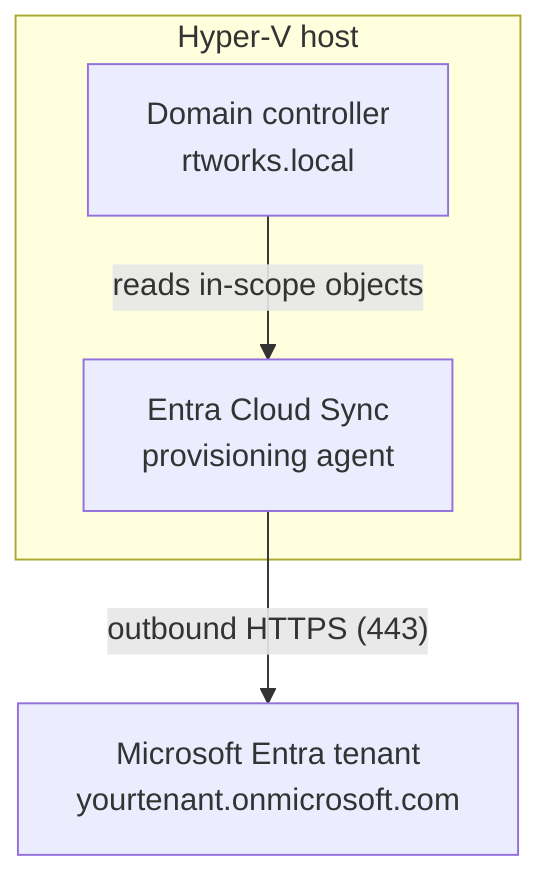
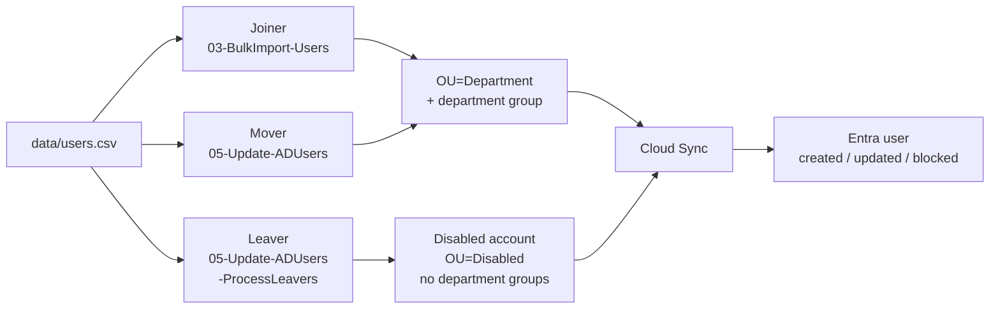

# Architecture: Hybrid Identity Lab

## 1. Summary

This lab connects an on-premises Active Directory Domain Services (AD DS) forest, `rtworks.local`, to a Microsoft Entra tenant with Entra Cloud Sync. PowerShell scripts provision and maintain the users, and the lab demonstrates how the UPN suffix changes what the cloud sees: users start on `@rtworks.local`, are synced, and are then migrated to the tenant's `.onmicrosoft.com` suffix.

The forest, domain controller and Hyper-V VM were built by hand following Microsoft's *Building a basic Active Directory environment* tutorial. The Cloud Sync agent was installed and configured by hand. The scripts take over from there.

## 2. Components



The agent only makes outbound connections, so the domain controller needs no inbound port open to the internet. Script `04-Test-CloudSyncAgent.ps1` checks the agent service, its service account, TLS settings, and reachability of the Microsoft endpoints.

## 3. Directory structure

```text
DC=rtworks,DC=local
├── OU=Domain Controllers
└── OU=CorpUsers                      (created by 01; the sync scope)
    ├── OU=IT                         (created by 03, one per department)
    ├── OU=HR
    ├── OU=Finance
    ├── OU=Sales
    ├── OU=Marketing
    ├── OU=Engineering
    ├── OU=Operations
    ├── OU=Legal
    ├── OU=Product
    ├── OU=Customer Support
    └── OU=Disabled                   (created by 05 when the first leaver is processed)
```

- `OU=CorpUsers` separates lab users from the built-in containers. It is protected from accidental deletion.
- Each department OU holds the users whose CSV `Department` matches. Each department also has a security group named `<Department>-Security-Group`, created by 03.
- `OU=Disabled` holds deprovisioned leavers. It sits inside `CorpUsers` on purpose, so disabled accounts stay in the sync scope and the disabled state reaches Entra.

## 4. UPN strategy and synchronization

The lab runs in two stages so the before and after can be compared.

| Stage | On-premises UPN | UPN seen in Entra | Notes |
|-------|-----------------|-------------------|-------|
| 1. Baseline | `user@rtworks.local` | `user@<tenant>.onmicrosoft.com` | `.local` is not routable and cannot be verified in Entra, so the cloud substitutes the tenant suffix. Confirm this in your own tenant. |
| 2. Migrated | `user@<tenant>.onmicrosoft.com` | `user@<tenant>.onmicrosoft.com` | After 02 registers the suffix and 06 changes each UPN, the two match. |

Cloud Sync matches on a source anchor, not on the UPN, so the baseline syncs without problems. Only the sign-in name differs.

**Cloud Sync scope.** The agent syncs objects from `OU=CorpUsers` and its sub-OUs, including `OU=Disabled`. Whether department groups sync, and which attributes (`DisplayName`, `Department`, `Title`, `Office`) are mapped, depends on the Cloud Sync configuration in the Entra admin center. Check the attribute mappings in your tenant and record them in `docs/images/`.

## 5. Identity lifecycle (joiner, mover, leaver)

The CSV (`data/users.csv`) is the source of truth. The scripts compare the directory with it and fix the difference.



| Event | Trigger | What happens |
|-------|---------|--------------|
| Joiner | New row in the CSV | 03 creates the user in the department OU with the initial password (change required at first logon) and adds it to the department group. |
| Mover | Department, title or office changed in the CSV | 05 moves the user to the new department OU, updates attributes, removes the old department group and adds the new one. |
| Leaver | Row removed from the CSV | With `-ProcessLeavers`, 05 disables the account, removes department groups, stamps the description, and moves it to `OU=Disabled`. Nothing is deleted. |
| Rehire | Leaver row returns to the CSV | 05 reports it as `Failed` and changes nothing. Re-enable and move the account by hand, then run 05. |

Safeguards: every script supports `-WhatIf`, validates all input before changing anything, and is safe to rerun. Leaver processing is opt-in and stops before any change if more than `-MaxLeavers` accounts would be processed.

## 6. Script map

| Script | Purpose |
|--------|---------|
| `01-Initialize-OUStructure.ps1` | Create `OU=CorpUsers` |
| `02-Configure-UPNSuffixes.ps1` | Register a UPN suffix in the forest |
| `03-BulkImport-Users.ps1` | Create department OUs, groups and users from the CSV |
| `04-Test-CloudSyncAgent.ps1` | Read-only health check of the sync agent |
| `05-Update-ADUsers.ps1` | Movers and leavers |
| `06-Set-UserUPN.ps1` | Move users to a new UPN suffix |
| `LabCommon.ps1` | Shared helpers, including CSV validation |

## 7. Validation

- **PSScriptAnalyzer** runs on `scripts/` in CI and fails on any finding.
- **Unit tests** (`tests/Data.Tests.ps1`, `tests/Scripts.Tests.ps1`) run in GitHub Actions without a domain controller. Active Directory is mocked, so they check which commands each script calls and with what, not the state of a real directory.
- **Integration tests** (`tests/IdentityLab.Integration.Tests.ps1`, tagged `Integration`) run on a domain controller and check the real OUs, groups and users. They also confirm that `05 -WhatIf` finds nothing to change.

Requirements and how each is verified are listed in `docs/REQUIREMENTS.md`.

## 8. Planned: Phase 3

GitHub Actions authenticates to Entra with an OIDC federated credential (no stored secret), deploys Conditional Access policies in report-only mode with break-glass accounts excluded, and Pester tests read the policy state back through Microsoft Graph.
